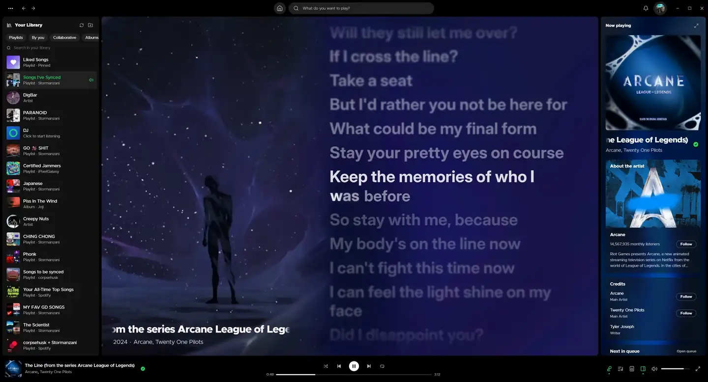

#  SpotiFlex

A Spotify desktop client written in Rust, with Spicy Lyrics built in instead of injected. It streams through [librespot](https://github.com/librespot-org/librespot), draws its own Tauri interface in Spotify's layout (library left, browsing centre, player bottom, lyrics right), and needs neither the Spotify app nor Spicetify.

[](#download-and-sign-in)
[](#building)
[](LICENSE)

> [!IMPORTANT]
> **You need Spotify Premium.** librespot cannot stream on free accounts. SpotiFlex is also early: some of Spotify's and Spicy Lyrics' features are still missing, and [docs/FEATURES.md](docs/FEATURES.md) lists which.

## Features

### Lyrics

- Word- and syllable-synced lyrics, taken from whichever of six sources answers best: Spicy Lyrics, Musixmatch, Apple Music, Spotify, LRCLIB or Netease. You choose the order in Settings.
- The Spicy Lyrics animator, with presets and adjustable motion settings, plus Space Gravity, where words drift across the page.
- The song's Spotify Canvas plays beside the lyrics and tints the background.
- Load your own `.lrc` or `.ttml` files, permanently or for one session.
- Community credits name the maker by their Discord username.

Press **F11** for full screen. Playback controls appear when you move the mouse and fade when you stop:


### Listening

Gapless playback by default, optional crossfade from 1 to 12 seconds, media keys, and Spotify Connect control of your other devices. Closing the window can leave music playing from the tray, and SpotiFlex can open at sign-in, minimized if you prefer.

### Your library

Every playlist loads after sign-in, including private and collaborative ones, inside the Spotify folders you made. Saved albums and followed artists sit alongside them in Spotify's Recents order, with filter chips for each kind.

### Elsewhere in the app

Spotify's Home feed, search, artist and album pages, Recents, and the What's New feed behind the bell. Now Playing has a lyrics card that can expand to fill the panel. Windows builds update themselves, after checking each download's Ed25519 signature and SHA-256 hash.

## Download and sign in

On Windows 10 or 11 (x64), download [SpotiFlex 0.1.1](https://updates.clypdat.xyz/releases/0.1.1/windows-x86_64/spotiflex.exe). On macOS 12 or later there is no release yet; see [Building](#building).

1. Open SpotiFlex. A setup window stays up until you sign in.
2. Choose **Sign in with Spotify** and approve the connection in your browser.
3. Back in SpotiFlex, the client unlocks once Spotify confirms the account.

Sign-in uses OAuth with PKCE through a state-checked loopback callback. You do not need a Spotify developer app, and later launches reuse the saved session.

## Privacy

Spotify credentials stay on your computer: Windows Credential Manager on Windows, AES-256-GCM encrypted files on macOS. Lyrics requests carry the Spotify track ID, and Spotify tokens are never sent to Spicy Lyrics.

<details>
<summary>Lyrics lookups: who receives what</summary>

Every build includes SpotiFlex's publishable Spicy Lyrics client key, so you do not need a Spicy Lyrics account. Lyric sources receive the track ID, title and artist they need to find a match. Answers are cached on disk for three days, separately for each source; **Settings > Storage** clears them.

Community credits show the maker's Discord username by looking up their public spicylyrics.org profile, as EeveeSpotifyReincarnated does. **Settings > Display** turns this off.

Self-hosted lyrics deployments can still be provisioned through standard input. That legacy mode asks for explicit consent before it sends a short-lived Spotify access token to the configured host, and it never sends refresh tokens or client secrets:

```powershell
Read-Host 'HTTPS lyrics host' | .\target\debug\spotiflex.exe --set-lyrics-host --allow-spotify-access-token
```

The host is kept in the credential store, not in source. Your DNS and network traffic still reveal where requests go.

</details>

<details>
<summary>Spotify services and the optional developer connection</summary>

Browsing, library changes, audio and Connect control go through the librespot session, using the same internal services as Spotify's desktop client. Those services are undocumented and can change; this is not an approved Spotify SDK integration.

An optional developer connection keeps the older Web API login. Create an app in the [Spotify Developer Dashboard](https://developer.spotify.com/dashboard), register `http://127.0.0.1:43821/callback`, and enter its Client ID in setup. Spotify's development-mode allowlist and quotas apply to it. No client secret is needed.

</details>

## Building

Windows needs Rust, Node.js 24, WebView2, the Visual Studio C++ build tools, CMake and LLVM (for libclang). Then:

```powershell
.\build.ps1          # build and install the latest main
.\build.ps1 local    # build the current checkout, uncommitted changes included
```

On macOS, install the Xcode Command Line Tools, Rustup, Node.js 24 and CMake (`brew install cmake`), then run `./build.sh` or `./build.sh local`.

<details>
<summary>What the build scripts do</summary>

By default each script requires a clean worktree, switches to `main`, fast-forwards from `origin/main`, restores npm dependencies, and builds a release. It installs the Rust version that `Cargo.toml` requires unless `RUSTUP_TOOLCHAIN` is set, and restores your original branch afterwards, including on failure. Nothing is pushed, and credentials and app data are left alone.

- **Windows** installs to `%LOCALAPPDATA%\Programs\SpotiFlex\spotiflex.exe`, closes a running copy first, and starts the new one. `-NoLaunch` installs without starting it. Builds from this script turn automatic updates off; run it again to update. If PowerShell blocks the script, use `powershell -ExecutionPolicy Bypass -File .\build.ps1`. The script finds Visual Studio's bundled CMake and LLVM's default folder; otherwise put CMake on `PATH` and set `LIBCLANG_PATH` to the folder that contains `libclang.dll`.
- **macOS** signs the bundle with a reusable self-signed certificate (an explicit `APPLE_SIGNING_IDENTITY` or `APPLE_CERTIFICATE` takes precedence, and `SPOTIFLEX_ADHOC_SIGNING=1` opts out), replaces `/Applications/SpotiFlex.app` and opens it. Credentials live encrypted under `~/Library/Application Support/SpotiFlex/credentials/`; keep `device.key` with them when backing up.
- `.\build.ps1 <branch>` or `./build.sh <branch>` builds another branch; a commit hash builds that commit.

To build by hand:

```powershell
npm ci
npm run build
cargo build --release --locked
.\target\release\spotiflex.exe
```

</details>

<details>
<summary>Releases and CI</summary>

The release workflow builds and tests the client, signs the update manifest, uploads the executable and source archive to the `spotiflex-releases` bucket, and activates the stable channel last. [docs/UPDATES.md](docs/UPDATES.md) has the maintainer steps. The **Build macOS app** workflow produces ad-hoc signed Apple Silicon and Intel `.app.zip` files when dispatched by hand; they are not notarized, and macOS builds do not update automatically.

</details>

## Development

```powershell
npm test                 # frontend unit tests (Vitest)
npm run test:e2e         # browser tests against a mocked desktop bridge (Playwright)
cargo fmt --check
cargo test --locked
cargo clippy --locked --all-targets -- -D warnings
```

At the time of writing, 234 Rust tests, 185 frontend unit tests and 183 browser tests pass. The browser tests use a mocked bridge, so they do not prove live Spotify behaviour. Keep `Cargo.lock` when updating dependencies: it pins `vergen` to 9.0.6 because librespot 0.8's build script breaks with vergen 9.1.0.

<details>
<summary>Current limits</summary>

- Remote-device commands and audio quality on other computers have not been verified by hand.
- Sign-in has not been tested end to end on an account outside the developer app's allowlist.
- Library ordering uses the last 50 played contexts from Spotify's play history; older items are ordered by when they were added.
- Spotify's public API does not expose folder metadata, so folders are read from Spotify's rootlist service.

The full list is in [docs/FEATURES.md](docs/FEATURES.md).

</details>

## Credits

- **[Spicy Lyrics](https://github.com/Spikerko/spicy-lyrics)** by Spikerko and its contributors, and **[iPixelGalaxy's fork](https://github.com/iPixelGalaxy/spicy-lyrics)**: the lyrics provider, the animator, Space Gravity, fullscreen lyrics and the Canvas backdrop that SpotiFlex reimplements.
- **[EeveeSpotifyReincarnated](https://github.com/iPixelGalaxy/EeveeSpotifyReincarnated)**: the lookup that shows Discord usernames on community lyrics.
- **[librespot](https://github.com/librespot-org/librespot)**: Spotify sign-in, streaming and Connect.
- **[Kawarp](https://github.com/better-lyrics/kawarp)** by Better Lyrics: the warped artwork ambience.
- **[spr](https://github.com/Fraktality/spr)** by Fraktality: the spring that moves the lyrics.
- **[Tauri](https://tauri.app)**, **[React](https://react.dev)** and **[Lucide](https://lucide.dev)** icons; **[Inter](https://rsms.me/inter/)** and **[Metropolis](https://fontsource.org/fonts/metropolis)** fonts.

---

SpotiFlex is licensed under the [GNU AGPL v3](LICENSE). The lyrics features reimplement behaviour from [iPixelGalaxy/spicy-lyrics](https://github.com/iPixelGalaxy/spicy-lyrics) and the pixels-spicy-lyrics fork (both AGPL-3.0), and community usernames follow [EeveeSpotifyReincarnated](https://github.com/iPixelGalaxy/EeveeSpotifyReincarnated) (GPL-3.0); no upstream source or assets are copied. Playback uses librespot (MIT). [NOTICE.md](NOTICE.md) and [THIRD_PARTY_NOTICES.md](THIRD_PARTY_NOTICES.md) list every source and license. Spotify is a trademark of Spotify AB; SpotiFlex is an independent client and is not affiliated with Spotify AB.
